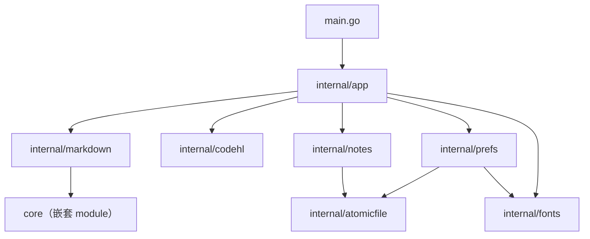

# Zakki 工程与架构标准

本文是本仓库的工程约束与目标架构。任何人或 agent 改代码前先读 [AGENTS.md](../AGENTS.md)，
动结构前读本文，动具体模块前读 [architecture.md](architecture.md)。

- 「必须 / 禁止」是硬规则，违反即不合格，评审直接打回。
- 「应 / 建议」是默认做法，偏离时在提交说明里写明理由。
- 布局与依赖迁移已完成；下文描述当前应维持的状态，不要在无关提交里顺手改结构。

## 1. 参考依据

| 来源 | 借鉴内容 |
|---|---|
| [Go 官方：Organizing a Go module](https://go.dev/doc/modules/layout) | 可执行程序入口留在模块根目录；不对外暴露的包放 `internal/`。**不**引入 `pkg/`。 |
| [Go Code Review Comments](https://go.dev/wiki/CodeReviewComments) | 包名短小、小写、名词；禁止 `util`/`common`/`helpers`；接口由使用方定义。 |
| [Google Go Style Guide](https://google.github.io/styleguide/go/) | 错误用 `%w` 包装；godoc 以标识符开头；测试写清 got/want。 |
| [Uber Go Style Guide](https://github.com/uber-go/guide/blob/master/style.md) | mutex 与保护字段同结构体；不嵌入 mutex；不用可变全局状态。 |
| MyGo（`go list -f '{{.Dir}}' github.com/egoist/mygo/ui`，见 `vendor/`) | 示例按领域分文件；`go tool mygo vet` 检查 UI 生命周期。 |
| [.agents/skills/mygo-maintenance/SKILL.md](../.agents/skills/mygo-maintenance/SKILL.md) | MyGo 生命周期、身份、线程与测试（第 4 节）。 |

## 2. 目标布局

薄入口 + 领域包：根目录只留 `main.go`（调 `internal/app.Run()`）；MyGo UI 在 `internal/app`；
解析、格式、持久化在其余 `internal` 包，可脱离 MyGo 单测。

```text
zakki/
├── core/                     # 共享数据内核（嵌套 module zakki/core，零第三方依赖）
├── mobile/                   # mobile/binding 独立 module（gomobile bind）+ mobile/ios iOS 工程
├── locales/                  # i18n；mygo generate → catalog_gen.go
├── main.go
├── internal/
│   ├── app/                  # 唯一可依赖 MyGo 的 internal 包
│   ├── markdown/             # 解析、格式、表格纯函数（时间令牌委托 core）
│   ├── codehl/               # 围栏代码块词法着色
│   ├── notes/                # 唯一笔记文件 zakki.json、定时保存与 Git 同步
│   ├── prefs/                # preferences.json
│   ├── fonts/                # 可选字体远程目录、校验与按需下载
│   └── atomicfile/           # tmp+rename 原子写
├── resources/  docs/  patches/  vendor/
├── build/  .mygo/            # 生成目录，已 gitignore
└── .github/workflows/        # ci.yml + release.yml
```

## 3. 依赖规则



**必须**：

1. 纯逻辑包禁止 import `github.com/egoist/mygo` 及其子包；领域类型在 `internal` 定义，由 `app` 转为 `ui.*`。
2. 纯逻辑包禁止依赖 `internal/app`。允许的 internal 依赖：

   | 包 | 允许依赖的 internal 包 |
   |---|---|
   | `app` | `markdown`、`codehl`、`notes`、`prefs`、`atomicfile`、`fonts`、`sysnotify` |
   | `markdown` | 无 |
   | `codehl` | 无 |
   | `atomicfile` | 无 |
   | `fonts` | 无 |
   | `sysnotify` | 无 |
   | `notes` | `atomicfile` |
   | `prefs` | `atomicfile`、`fonts` |

3. 新增包或依赖边：同一次提交更新本节与 `Makefile` 的 `ARCH_RULES`，并跑 `make arch-check`。
4. 第三方依赖新增须在提交说明写明理由；当前仅 `github.com/egoist/mygo`。
5. **共享内核 `core/`（嵌套 module `zakki/core`）铁律**：
   - 叶子模块：零第三方依赖（`core/go.mod` 不得出现 `require`）、禁止依赖 MyGo 与任何 `zakki/internal/*`，`make arch-check` 直接校验；
   - 单一事实源：时间令牌（`@`/`~`/`^`）与重复实例展开的语义只在 `core` 写一份，桌面 `internal/markdown` 与未来移动端（gomobile bind）都是消费方，禁止各自持拷贝；
   - 对外边界只跨字符串、数值、布尔与 JSON（gomobile 形状）；
   - 内部包 `markdown` 允许且仅允许额外依赖 `core`；测试随 `make test`/`make race` 经 `go -C core` 执行；
   - 移动端绑定同仓：`mobile/binding` 是独立 Go module（`require zakki/core` 并 `replace => ../../core`），是**唯一允许依赖 golang.org/x/mobile 的模块**；`mobile/ios` 是 XcodeGen 工程，不参与任何 Go 构建；两者都不参与桌面 `make check` 的根 module 构建与测试，core 仍是零依赖叶子。

机械校验：`make arch-check`（实现见根目录 `Makefile`，已纳入 `make check` 与 CI）。

## 4. 状态与并发规则

### 4.1 `app` 是装配根

- `app` 由领域子结构体与 `notes.Store` / `prefs.Store` 组合，禁止往 `app` 顶层新增零散字段。
- 子结构体方法优先定义在子结构体上；跨领域协作再用 `(a *app)`。

### 4.2 线程边界

- 主线程专属状态不加锁，后台不读。
- 可并发访问的状态封装在 Store（`notes`、`prefs`）内部 mutex；`app` 不直接持锁。
- 后台只处理主线程拍下的不可变快照；回主线程只用 `Window.Update`。

### 4.3 MyGo 规则（必须遵守）

- 禁止跨帧存储 `ui.Element`；持久身份用 `ui.Handle` + `.Bind`。
- 禁止把 `*ui.Context` 存入状态或传给后台；持久回调用 `c.Services()`。
- 有状态控件构建前 `c.Key(key)`；副作用放在动作回调或显式任务，不在无条件渲染路径。
- 慢 I/O 与重计算不在 UI 线程。

## 5. 编码规范

- 自有非测试文件超过 **800 行必须拆分**（`vendor/` 与生成文件除外，如 `go tool mygo generate` 产物 `locales/catalog_gen.go`）；`internal/app` 按 `live_*`、`view_*` 等前缀命名。
- 测试文件与被测文件同前缀。禁止 `util`/`common`/`helpers` 包名。
- 注释用中文，只写代码表达不出的约束；导出标识符有 godoc。
- `zakki.json`、`preferences.json` 格式与迁移语义是用户契约；改格式须递增版本、补迁移测试，并更新 architecture / configuration。

## 6. 测试与工程化

| 层 | 位置 | 要求 |
|---|---|---|
| 纯逻辑 | `internal/<pkg>/*_test.go` | 表驱动；不依赖 MyGo |
| 持久化 | `notes`、`prefs` | `t.TempDir()` + 注入时钟；不写真实用户目录 |
| UI | `internal/app/*_test.go` | `ui.NewTester`、`newTestApp(t)` |

修 bug 先补失败测试。检查命令以 [AGENTS.md](../AGENTS.md) 与 `Makefile` 为准；**每次提交前 `make check` 全绿**。
CI（`.github/workflows/ci.yml`）不得跳过测试或放宽检查。

## 7. 评审清单

- [ ] `make check` 全绿
- [ ] 一次提交一件事；结构迁移不夹带行为变更
- [ ] 纯逻辑包无 MyGo；依赖符合第 3 节
- [ ] 无 `ui.Element`/`*ui.Context` 入状态；后台只碰快照
- [ ] 文件职责变化已同步 [architecture.md](architecture.md)
- [ ] 未提交 `build/`、`.mygo/`、二进制与签名私钥
