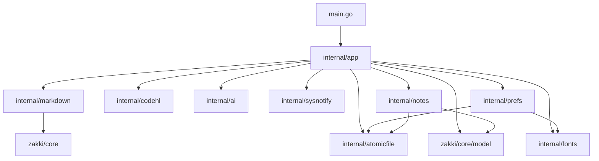

> *本文書は日本語訳です。内容は[中国語の原文](../engineering-standard.md)を正とし、翻訳が遅れている場合があります。*

# Zakki エンジニアリング標準とアーキテクチャ

本文はこのリポジトリのエンジニアリング上の制約と目標アーキテクチャです。人も agent も、コードを変更する前にまず[AGENTS.md](../../AGENTS.md)（中国語）を読み、
構造を変える前に本文を読み、具体的なモジュールを変える前に [アーキテクチャ](architecture.md) を読んでください。

- 「必須 / 禁止」はハードルールで、違反は不合格、レビューはそのまま差し戻されます。
- 「望ましい / 推奨」は既定のやり方で、逸脱する場合はコミットメッセージに理由を書きます。
- レイアウトと依存の移行は完了しています；以下は現在維持すべき状態を記述します。無関係なコミットでついでに構造を変えないでください。

## 1. 参考の根拠

| 出典 | 取り入れた内容 |
|---|---|
| [Go 公式：Organizing a Go module](https://go.dev/doc/modules/layout) | 実行可能プログラムのエントリはモジュールのルートに置く；外部に公開しないパッケージは `internal/` に置く。`pkg/` は**導入しない**。 |
| [Go Code Review Comments](https://go.dev/wiki/CodeReviewComments) | パッケージ名は短く、小文字、名詞；`util`/`common`/`helpers` は禁止；インターフェースは利用側が定義する。 |
| [Google Go Style Guide](https://google.github.io/styleguide/go/) | エラーは `%w` でラップする；godoc は識別子で始める；テストは got/want を明記する。 |
| [Uber Go Style Guide](https://github.com/uber-go/guide/blob/master/style.md) | mutex は保護するフィールドと同じ構造体に置く；mutex を埋め込まない；可変なグローバル状態を使わない。 |
| MyGo（`go list -f '{{.Dir}}' github.com/egoist/mygo/ui`、`vendor/` を参照） | サンプルは領域ごとにファイルを分ける；`go tool mygo vet` が UI ライフサイクルを検査する。 |
| [.agents/skills/mygo-maintenance/SKILL.md](../../.agents/skills/mygo-maintenance/SKILL.md)（中国語） | MyGo のライフサイクル、同一性、スレッド、テスト（第 4 節）。 |

## 2. 目標レイアウト

薄いエントリ + 領域パッケージ：ルートには `main.go` だけを残し（`internal/app.Run()` を呼ぶ）；MyGo UI は `internal/app`；解析、フォーマット、
永続化は残りの `internal` パッケージにあり、MyGo を切り離して単体テストできます。

```text
zakki/
├── core/                     # 共有データカーネル（ネストした module zakki/core、第三者依存なし）
├── mobile/                   # 【2026-11-11 凍結】mobile/binding は独立 module（gomobile bind）+ mobile/ios は iOS プロジェクト。docs/mobile-archive.md 参照
├── locales/                  # i18n；mygo generate → catalog_gen.go
├── main.go
├── internal/
│   ├── app/                  # MyGo に依存できる唯一の internal パッケージ
│   ├── ai/                   # OpenAI 互換の補完と構造化された提案（純粋ロジック）
│   ├── markdown/             # 解析、整形、表の純関数（時刻トークンは core に委譲）
│   ├── codehl/               # フェンス付きコードブロックの字句着色
│   ├── notes/                # 唯一のノートファイル zakki.json、定期保存と Git 同期
│   ├── prefs/                # preferences.json
│   ├── fonts/                # 任意フォントのリモートカタログ、検証とオンデマンド取得
│   └── atomicfile/           # tmp+rename の原子的書き込み
├── resources/  docs/  patches/  vendor/
├── build/  .mygo/            # 生成物ディレクトリ（gitignore 済み）
└── .github/workflows/        # ci.yml + release.yml
```

## 3. 依存ルール



**必須**：

1. 純粋ロジックパッケージは `github.com/egoist/mygo` とそのサブパッケージを import してはならない；領域の型は `internal` で定義し、
   `app` が `ui.*` に変換する。
2. 純粋ロジックパッケージは `internal/app` に依存してはならない。許可される internal 依存：

   | パッケージ | 依存してよい internal パッケージ |
   |---|---|
   | `app` | `markdown`、`codehl`、`notes`、`prefs`、`atomicfile`、`ai`、`fonts`、`sysnotify` |
   | `markdown` | なし |
   | `codehl` | なし |
   | `atomicfile` | なし |
   | `ai` | なし |
   | `fonts` | なし |
   | `sysnotify` | なし |
   | `notes` | `atomicfile` |
   | `prefs` | `atomicfile`、`fonts` |

3. パッケージや依存辺を追加する場合：同じコミットで本節と `Makefile` の `ARCH_RULES` を更新し、`make arch-check` を実行する。
4. サードパーティ依存の追加はコミットメッセージに理由を書く必要がある；現在は `github.com/egoist/mygo` のみ。
5. **共有カーネル `core/`（入れ子 module `zakki/core`）の鉄則**：
   - リーフモジュール：サードパーティ依存ゼロ（`core/go.mod` に `require` を書いてはならない）、MyGo とあらゆる `zakki/internal/*` への依存を禁止、
     `make arch-check` が直接検証する；
   - 単一の真実の源：時間トークン（`@`/`~`/`^`）と繰り返しインスタンス展開の意味論は `core` に 1 か所だけ書き、デスクトップの `internal/markdown` と将来のモバイル
     （gomobile bind）は消費側であり、それぞれがコピーを持ってはならない；
   - 文字列、数値、真偽値、JSON に限定するのは `core/zakkicore` の gomobile バインディングのみ。デスクトップからの Go 呼び出しには適用しない；
   - デスクトップの `internal/markdown` は `zakki/core` の時刻処理に、`internal/notes` は `zakki/core/model` のディスクモデルと移行処理に、`internal/app` は同パッケージのタブ数の定数に依存する。コアのテストは `make test` / `make race` から `go -C core` 経由で実行する；
   - モバイルバインディングは同リポジトリ：`mobile/binding` は独立した Go module（`require zakki/core` と `replace => ../../core`）で、
     **golang.org/x/mobile への依存を唯一許されるモジュール**；`mobile/ios` は XcodeGen プロジェクトで、いかなる Go ビルドにも参加しない；
     どちらもデスクトップの `make check` におけるルート module のビルドとテストには参加せず、core は依然として依存ゼロのリーフ。
     モバイルは 2026-11-11 に凍結済み（[モバイルクライアントのアーカイブ](mobile-archive.md)）だが、バインディングは引き続きコンパイルできなければならない。

機械的な検証：`make arch-check`（実装はルートの `Makefile`、`make check` と CI に含まれる）。

## 4. 状態と並行性のルール

### 4.1 `app` は組み立てのルート

- `app` は領域ごとの子構造体と `notes.Store` / `prefs.Store` の組み合わせで、`app` のトップレベルに散発的なフィールドを追加してはならない。
- 子構造体のメソッドは子構造体に定義するのが優先；領域をまたぐ協調でのみ `(a *app)` を使う。

### 4.2 スレッド境界

- メインスレッド専用の状態にはロックをかけず、バックグラウンドは読まない。
- 並行アクセスされる状態は Store（`notes`、`prefs`）内部の mutex にカプセル化する；`app` は直接ロックを持たない。
- バックグラウンドはメインスレッドが撮った不変スナップショットのみを扱う；メインスレッドへ戻るのは `Window.Update` のみ。

### 4.3 MyGo のルール（必ず守る）

- フレームをまたいで `ui.Element` を保存してはならない；永続的な同一性には `ui.Handle` + `.Bind` を使う。
- `*ui.Context` を状態に保存したりバックグラウンドに渡したりしてはならない；永続コールバックには `c.Services()` を使う。
- 状態を持つコントロールは構築前に `c.Key(key)` を呼ぶ；副作用は動作コールバックか明示的なタスクに置き、無条件の描画経路に置かない。
- 遅い I/O と重い計算は UI スレッドで行わない。

## 5. コーディング規範

- 自前の非テストファイルが **800 行を超えたら分割必須**（`vendor/` と生成ファイル、たとえば `go tool mygo generate` の成果物
  `locales/catalog_gen.go` は除く）；`internal/app` は `live_*`、`view_*` などの接頭辞で命名する。
- テストファイルは対象ファイルと同じ接頭辞にする。`util`/`common`/`helpers` というパッケージ名は禁止。
- コメントは中国語で書き、コードで表現できない制約のみを書く；エクスポートされた識別子には godoc を付ける。
- `zakki.json`、`preferences.json` の形式と移行の意味論はユーザーとの契約；形式を変えるときはバージョンを上げ、移行テストを追加し、
  architecture / configuration を更新する。

## 6. テストとエンジニアリング

| 層 | 場所 | 要件 |
|---|---|---|
| 純粋ロジック | `internal/<pkg>/*_test.go` | テーブル駆動；MyGo に依存しない |
| 永続化 | `notes`、`prefs` | `t.TempDir()` + 時計の注入；実際のユーザーディレクトリに書かない |
| UI | `internal/app/*_test.go` | `ui.NewTester`、`newTestApp(t)` |

バグを直すときはまず失敗するテストを追加します。検査ターゲットの実装は [Makefile](../../Makefile) を参照してください；
**コミット前に毎回 `make check` を全緑にします**。CI （`.github/workflows/ci.yml`）はテストをスキップしたり検査を緩めたりしてはなりません。

## 7. レビューチェックリスト

- [ ] `make check` が全緑
- [ ] 1 コミットにつき 1 つの事柄；構造の移行に挙動変更を混ぜない
- [ ] 純粋ロジックパッケージに MyGo がない；依存が第 3 節に適合
- [ ] `ui.Element`/`*ui.Context` を状態に入れていない；バックグラウンドはスナップショットにしか触れない
- [ ] ファイルの責務の変化を [アーキテクチャ](architecture.md) に反映済み
- [ ] `build/`、`.mygo/`、バイナリ、署名秘密鍵をコミットしていない
