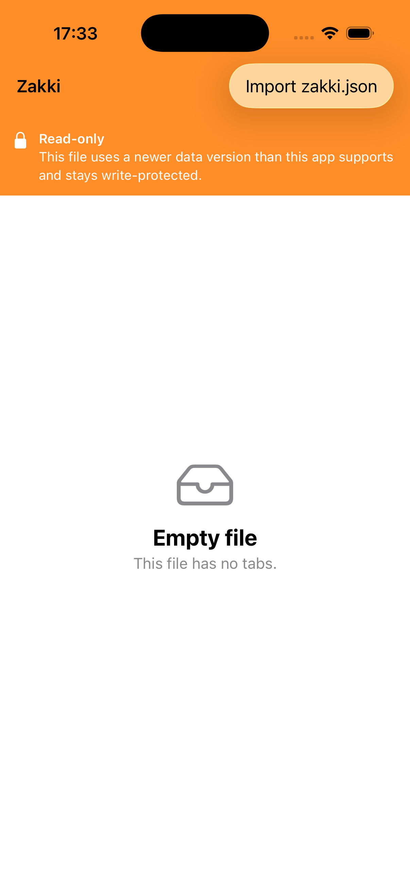

# 2026-10-28 移动端 M1 iOS 脚手架验证记录

对应 [docs/mobile-spec.md](../mobile-spec.md) §7 里程碑 M1 的 iOS 侧：`mobile/ios` 工程、
绑定产物链接、只读导入管道、单测与 CI。桌面侧 5 个提交（model 提取、绑定、
`make mobile-framework`）已先行合入 `feat/m1-scaffold`，本记录只覆盖 iOS 侧
`feat:`/`ci:` 提交的验证过程与结果。样例数据全部为合成 JSON，不含任何真实用户数据。

## 实现范围

| 项 | 结果 |
|---|---|
| XcodeGen 工程 | `mobile/ios/project.yml` 生成 `Zakki.xcodeproj`（不入库）；app target `com.gomeen.zakki.ios`，部署目标 iOS 17.0，SWIFT_VERSION=5（Swift 6 编译器语言模式 5） |
| 绑定链接 | `Frameworks/Zakkicore.xcframework`（make mobile-framework 产物，不入库；ios-arm64 + ios-arm64_x86_64-simulator 双 slice） |
| 导入管道 | 系统文件选择器（UTType.json，asCopy）与启动参数 `-ZakkiImportPath` 共用同一条「读字节 → 原子复制到沙盒 Application Support/zakki.json → DecodeNotes」管道；启动时沙盒已有文件则直接加载 |
| 只读界面 | 标签列表（名称、十六进制色点、正文首行）；`active` 行带 Current 徽标；`writable=false` 时顶部写保护横幅按 reason 给文案；文案集中在 `Strings.swift`（英文源字符串，M2 接 i18n） |
| 单测 | `ZakkiTests/NotesBindingTests`：8 条，直接对绑定封装层喂合成 JSON |
| CI | `.github/workflows/mobile.yml`（macos-latest，paths 过滤 mobile/core）+ 桌面 `ci.yml` paths-ignore mobile/** |

## 自动化验证

构建与单测在本机（Intel Mac，Xcode 26.5 / 17F42）执行：

1. `make mobile-framework` → 产出双 slice XCFramework。
2. `xcodegen generate`（mobile/ios 下）→ 生成 `Zakki.xcodeproj`。
3. `xcodebuild test -project Zakki.xcodeproj -scheme Zakki -destination 'platform=iOS Simulator,name=iPhone 17,OS=26.5'`：

```
Test Suite 'All tests' started at 2026-10-28 17:34:16.344.
Test Case '-[ZakkiTests.NotesBindingTests testBrokenJSONReportsInvalid]' passed (0.016 seconds).
Test Case '-[ZakkiTests.NotesBindingTests testEncodeKeepsDesktopOnlySettings]' passed (0.011 seconds).
Test Case '-[ZakkiTests.NotesBindingTests testEncodePreservesUnknownFieldsAtThreeLevels]' passed (0.006 seconds).
Test Case '-[ZakkiTests.NotesBindingTests testEncodeRejectsWriteProtectedVersions]' passed (0.010 seconds).
Test Case '-[ZakkiTests.NotesBindingTests testTenTabsIsWriteProtectedAsTooManyTabs]' passed (0.005 seconds).
Test Case '-[ZakkiTests.NotesBindingTests testV2LegacyKeepsTabsForReadOnlyDisplay]' passed (0.005 seconds).
Test Case '-[ZakkiTests.NotesBindingTests testV3NormalDecodesWritableWithTabs]' passed (0.005 seconds).
Test Case '-[ZakkiTests.NotesBindingTests testV4TooNewIsWriteProtectedWithoutTabs]' passed (0.005 seconds).
Test Suite 'All tests' passed at 2026-10-28 17:34:16.768.
	 Executed 8 tests, with 0 failures (0 unexpected) in 0.038 (0.053) seconds
** TEST SUCCEEDED **
```

覆盖点与 M1 出口标准对应：v3 正常（ok/writable/tabs 解析）、v4 版本过高
（versionTooNew、无 tabs）、10 标签（tooManyTabs 不截断）、v2（legacyVersion、tabs
原样）、非法 JSON（invalid）、三层未知字段经 EncodeNotes 修改已知字段后原样保留、
桌面专属 `alwaysOnTop`/`hideOnEscape` 原值不变、写保护版本 EncodeNotes 拒绝并返回
`write_protected` 错误码。

## 模拟器实测

`simctl boot` iPhone 17（iOS 26.5，x86_64 模拟器 slice）后安装 app，
用 `simctl launch booted com.gomeen.zakki.ios -ZakkiImportPath <样例>` 走与文件选择器
相同的导入管道（两个样例均为合成数据）。

### v3 正常多标签（active=1）


观察：3 行标签全部展示——Inbox（红点 `#d4253a`，首行 "Buy milk and coffee beans"）、
Ideas（蓝点 `#0f75e9`，右下 Current 徽标对应磁盘 `active=1`）、Scratch（空颜色串
回退中性灰点，空正文显示 "(empty)" 占位）；无写保护横幅，顶栏为导入入口按钮。

### v4 版本过高（写保护）



观察：顶部橙色 Read-only 横幅（锁图标 + reason=versionTooNew 文案 "This file uses a
newer data version than this app supports and stays write-protected."）；列表区域为
"Empty file / This file has no tabs."，与契约一致——写保护场景 DecodeNotes 不返回
tabs，界面不虚构内容、不提供编辑。

## 实测中发现并修复的问题

- 首次实测导入报 "The folder "zakki.json" doesn't exist."：全新沙盒里
  Application Support 目录不存在，原子写因父目录缺失失败。已在 `NotesModel.install`
  先 `createDirectory(withIntermediateDirectories: true)` 再原子复制；重测通过。
- gomobile 生成的自由函数（如 `ZakkicoreDecodeNotes`）返回值标注 `_Nonnull`，
  Swift 导入器不套用 throws 约定，`NSError**` 成为显式 `NSErrorPointer` 参数；
  封装层按「先查 err 再用返回值」处理，错误码从 `localizedDescription` 的
  `code: 说明` 前缀解析（`NotesCoreError.code`）。

## 已知边界

- 模拟器为 Intel Mac 上的 x86_64 slice；真机（arm64）构建产物已在 xcframework 内
  （ios-arm64），但真机签名、运行与性能验证推迟到 M3（免费个人签名 7 天重签演练同批）。
- 文件选择器入口只做了人工核验（asCopy 临时副本与启动参数走同一管道，单测覆盖管道
  后半段）；无自动化 UI 测试，M2 引入编辑时再评估 XCUITest 成本。
- 文案为英文源字符串集中于一处（`Strings.swift`），与桌面 locales 的 i18n 接线属 M2。
- CI（mobile.yml）在 runner 上的首次运行待 PR 触发后确认；destination 从
  `simctl list devices available` 动态解析首个 iPhone，不硬编码本地型号。
