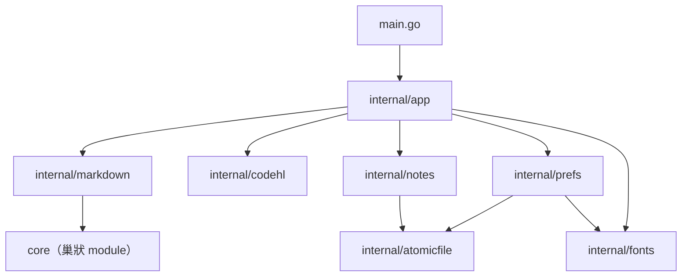

> *本文為繁體中文（台灣）譯本，內容以[中文原文](../engineering-standard.md)為準，可能落後。*

# Zakki 工程與架構標準

本文是本儲存庫的工程約束與目標架構。任何人或 agent 改程式碼前先讀 [AGENTS.md](../../AGENTS.md)（中文），
動結構前讀本文，動具體模組前讀 [architecture.md](architecture.md)。

- 「必須 / 禁止」是硬規則，違反即不合格，評審直接退回。
- 「應 / 建議」是預設做法，偏離時在提交說明裡寫明理由。
- 版面與依賴移轉已完成；下文描述目前應維持的狀態，不要在無關提交裡順手改結構。

## 1. 參考依據

| 來源 | 借鑑內容 |
|---|---|
| [Go 官方：Organizing a Go module](https://go.dev/doc/modules/layout) | 可執行程式進入點留在 module 根目錄；不對外暴露的套件放 `internal/`。**不**引入 `pkg/`。 |
| [Go Code Review Comments](https://go.dev/wiki/CodeReviewComments) | 套件名短小、小寫、名詞；禁止 `util`/`common`/`helpers`；介面由使用方定義。 |
| [Google Go Style Guide](https://google.github.io/styleguide/go/) | 錯誤用 `%w` 包裝；godoc 以識別字開頭；測試寫清 got/want。 |
| [Uber Go Style Guide](https://github.com/uber-go/guide/blob/master/style.md) | mutex 與保護欄位同結構體；不嵌入 mutex；不用可變全域狀態。 |
| MyGo（`go list -f '{{.Dir}}' github.com/egoist/mygo/ui`，見 `vendor/`) | 範例按領域分文件；`go tool mygo vet` 檢查 UI 生命週期。 |
| [.agents/skills/mygo-maintenance/SKILL.md](../../.agents/skills/mygo-maintenance/SKILL.md)（英文） | MyGo 生命週期、身分、執行緒與測試（第 4 節）。 |

## 2. 目標版面

薄進入點 + 領域套件：根目錄只留 `main.go`（呼叫 `internal/app.Run()`）；MyGo UI 在 `internal/app`；
解析、格式、持久化在其餘 `internal` 套件，可脫離 MyGo 單元測試。

```text
zakki/
├── core/                     # 共享資料核心（巢狀 module zakki/core，零第三方依賴）
├── mobile/                   # 【已凍結 2026-11-11】mobile/binding 獨立 module（gomobile bind）+ mobile/ios iOS 專案，見 docs/mobile-archive.md
├── locales/                  # i18n；mygo generate → catalog_gen.go
├── main.go
├── internal/
│   ├── app/                  # 唯一可依賴 MyGo 的 internal 套件
│   ├── markdown/             # 解析、格式、表格純函式（時間權杖委託 core）
│   ├── codehl/               # 圍籬程式碼區塊詞法著色
│   ├── notes/                # 唯一筆記檔案 zakki.json、定時儲存與 Git 同步
│   ├── prefs/                # preferences.json
│   ├── fonts/                # 可選字型遠端目錄、驗證與按需下載
│   └── atomicfile/           # tmp+rename 原子寫
├── resources/  docs/  patches/  vendor/
├── build/  .mygo/            # 產生目錄，已 gitignore
└── .github/workflows/        # ci.yml + release.yml
```

## 3. 依賴規則



**必須**：

1. 純邏輯套件禁止 import `github.com/egoist/mygo` 及其子套件；領域型別在 `internal` 定義，由 `app` 轉為 `ui.*`。
2. 純邏輯套件禁止依賴 `internal/app`。允許的 internal 依賴：

   | 套件 | 允許依賴的 internal 套件 |
   |---|---|
   | `app` | `markdown`、`codehl`、`notes`、`prefs`、`atomicfile`、`fonts`、`sysnotify` |
   | `markdown` | 無 |
   | `codehl` | 無 |
   | `atomicfile` | 無 |
   | `fonts` | 無 |
   | `sysnotify` | 無 |
   | `notes` | `atomicfile` |
   | `prefs` | `atomicfile`、`fonts` |

3. 新增套件或依賴邊：同一次提交更新本節與 `Makefile` 的 `ARCH_RULES`，並跑 `make arch-check`。
4. 第三方依賴新增須在提交說明寫明理由；目前僅 `github.com/egoist/mygo`。
5. **共享核心 `core/`（巢狀 module `zakki/core`）鐵律**：
   - 葉節點 module：零第三方依賴（`core/go.mod` 不得出現 `require`）、禁止依賴 MyGo 與任何 `zakki/internal/*`，`make arch-check` 直接驗證；
   - 單一事實來源：時間權杖（`@`/`~`/`^`）與重複實例展開的語意只在 `core` 寫一份，桌面 `internal/markdown` 與未來行動端（gomobile bind）都是消費方，禁止各自持副本；
   - 對外邊界只跨字串、數值、布林與 JSON（gomobile 形狀）；
   - 內部套件 `markdown` 允許且僅允許額外依賴 `core`；測試隨 `make test`/`make race` 經 `go -C core` 執行；
   - 行動端綁定同倉：`mobile/binding` 是獨立 Go module（`require zakki/core` 並 `replace => ../../core`），是**唯一允許依賴 golang.org/x/mobile 的 module**；`mobile/ios` 是 XcodeGen 專案，不參與任何 Go 建置；兩者都不參與桌面 `make check` 的根 module 建置與測試，core 仍是零依賴葉節點。行動端已於 2026-11-11 凍結（[mobile-archive.md](mobile-archive.md)），綁定仍須能編譯。

機械驗證：`make arch-check`（實作見根目錄 `Makefile`，已納入 `make check` 與 CI）。

## 4. 狀態與並行規則

### 4.1 `app` 是裝配根

- `app` 由領域子結構體與 `notes.Store` / `prefs.Store` 組合，禁止往 `app` 頂層新增零散欄位。
- 子結構體方法優先定義在子結構體上；跨領域協作再用 `(a *app)`。

### 4.2 執行緒邊界

- 主執行緒專屬狀態不加鎖，背景不讀。
- 可並行存取的狀態封裝在 Store（`notes`、`prefs`）內部 mutex；`app` 不直接持鎖。
- 背景只處理主執行緒拍下的不可變快照；回主執行緒只用 `Window.Update`。

### 4.3 MyGo 規則（必須遵守）

- 禁止跨影格儲存 `ui.Element`；持久身分用 `ui.Handle` + `.Bind`。
- 禁止把 `*ui.Context` 存入狀態或傳給背景；持久回呼用 `c.Services()`。
- 有狀態控制項建構前 `c.Key(key)`；副作用放在動作回呼或顯式任務，不在無條件繪製路徑。
- 慢速 I/O 與重計算不在 UI 執行緒。

## 5. 編碼規範

- 自有非測試檔案超過 **800 行必須拆分**（`vendor/` 與產生檔案除外，如 `go tool mygo generate` 產物 `locales/catalog_gen.go`）；`internal/app` 按 `live_*`、`view_*` 等前綴命名。
- 測試檔案與被測檔案同前綴。禁止 `util`/`common`/`helpers` 套件名。
- 註解用中文，只寫程式碼表達不出的約束；匯出識別字有 godoc。
- `zakki.json`、`preferences.json` 格式與移轉語意是使用者契約；改格式須遞增版本、補移轉測試，並更新 architecture / configuration。

## 6. 測試與工程化

| 層 | 位置 | 要求 |
|---|---|---|
| 純邏輯 | `internal/<pkg>/*_test.go` | 表驅動；不依賴 MyGo |
| 持久化 | `notes`、`prefs` | `t.TempDir()` + 注入時鐘；不寫真實使用者目錄 |
| UI | `internal/app/*_test.go` | `ui.NewTester`、`newTestApp(t)` |

修 bug 先補失敗測試。檢查指令以 [AGENTS.md](../../AGENTS.md)（中文）與 `Makefile` 為準；**每次提交前 `make check` 全綠**。
CI（`.github/workflows/ci.yml`）不得跳過測試或放寬檢查。

## 7. 評審清單

- [ ] `make check` 全綠
- [ ] 一次提交一件事；結構移轉不夾帶行為變更
- [ ] 純邏輯套件無 MyGo；依賴符合第 3 節
- [ ] 無 `ui.Element`/`*ui.Context` 入狀態；背景只碰快照
- [ ] 文件職責變化已同步 [architecture.md](architecture.md)
- [ ] 未提交 `build/`、`.mygo/`、二進位檔與簽章私鑰
